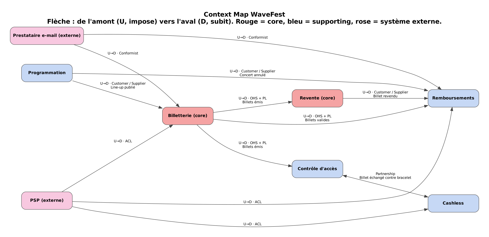

# Context Map · WaveFest

> TP2 · Recopié du Miro, cadres **06 · Bounded Contexts** et **07 · Context Map**.
> Flèche : de l'amont (**U**, impose) vers l'aval (**D**, subit). Le pattern est écrit sur le lien. Rouge = core, bleu = supporting, rose = système externe.

## Les 6 Bounded Contexts (cadre 06)

Découpés à partir des sous-domaines (cadre 03). Chaque frontière suit un changement de sens des mots ou de règles métier.

| Contexte | Classement | Objectif |
|---|---|---|
| **Billetterie** | 🟥 Core | Vendre les pass en vagues à prix croissant et émettre des billets nominatifs. Elle est la source de vérité sur qui détient quel billet et à quel prix. |
| **Revente officielle** | 🟥 Core | Permettre à un titulaire de revendre son billet à un autre festivalier, au prix plafond. Elle combat le marché noir et prélève 5 % de commission. |
| **Contrôle d'accès** | 🟦 Supporting | Vérifier le billet au portique et l'échanger contre un bracelet. Ici, un billet n'est qu'un QR à scanner, valide ou non. |
| **Cashless** | 🟦 Supporting | Gérer le solde du bracelet : recharges, consommations et remboursement du solde. Le mot « billet » n'existe pas ici : on parle de bracelet. |
| **Programmation** | 🟦 Supporting | Publier le line-up et les horaires décidés par l'organisateur. Elle annonce aussi l'annulation d'un concert aux autres contextes. |
| **Remboursements** | 🟦 Supporting | Appliquer les règles maison quand un concert est annulé : 50 % du prix payé au titulaire actuel si c'est la tête d'affiche. Elle pilote les campagnes et les relances du PSP. |

**Hors contextes (solutions achetées) :** Paiement → PSP (via ACL) · Notifications → Prestataire e-mail (Conformist) · Comptes festivaliers → fournisseur d'identité · Fourniture des bracelets → fabricant.

## Relations de la Context Map (cadre 07)

| # | Amont (U) | Aval (D) | Pattern | Ce qui circule | Pourquoi |
|---|---|---|---|---|---|
| 1 | Programmation | Billetterie | Customer / Supplier | Événement *Line-up publié* | La Billetterie a besoin du programme pour vendre les pass et peut peser sur les priorités de la Programmation. |
| 2 | Programmation | Remboursements | Customer / Supplier | Événement *Concert annulé* | Les Remboursements ouvrent une campagne quand une tête d'affiche est annulée. |
| 3 | Billetterie | Contrôle d'accès | OHS + Published Language | Événement *Billets émis* | La Billetterie sert plusieurs consommateurs avec un langage publié. |
| 4 | Billetterie | Revente officielle | OHS + Published Language | Événement *Billets émis* | Seul un billet émis peut être mis en revente. |
| 5 | Billetterie | Remboursements | OHS + Published Language | Requête *Billets valides de la journée* (titulaire actuel, prix payé), commande *Marquer le billet remboursé* | Les Remboursements n'ont pas à connaître les commandes ni les vagues. |
| 6 | Revente officielle | Remboursements | Customer / Supplier | Événement *Billet revendu* ; demande de retrait des annonces de la journée | Le racheteur est remboursé à 50 % de son prix de rachat. |
| 7 | Contrôle d'accès | Cashless | Partnership | Événement *Billet échangé contre bracelet* (ouvre le solde) | Le même bracelet sert à entrer et à payer : les deux équipes réussissent ou échouent ensemble. |
| 8 | PSP (externe) | Billetterie | ACL | Paiement / *Paiement confirmé*, *Paiement refusé* | Modèle étranger qu'on ne peut pas modifier ; l'ACL traduit son vocabulaire. |
| 9 | PSP (externe) | Cashless | ACL | Recharge, remboursement du solde | Même raison. |
| 10 | PSP (externe) | Remboursements | ACL | Remboursement / *Remboursement effectué*, *Remboursement échoué* | Même raison ; les relances restent côté Remboursements. |
| 11 | Prestataire e-mail (externe) | Billetterie | Conformist | Envoi de la confirmation d'achat | Service du marché : on adopte son modèle tel quel. |
| 12 | Prestataire e-mail (externe) | Remboursements | Conformist | Envoi des e-mails de remboursement et d'information | Même raison. |

## Le mot « billet » selon le contexte

| Contexte | Sens |
|---|---|
| Billetterie | Exemplaire d'un pass, au nom d'un titulaire, avec un prix payé. |
| Revente officielle | Objet d'une annonce, vendu au prix plafond. |
| Contrôle d'accès | QR à scanner, valide ou non. |
| Remboursements | Ligne à rembourser : un titulaire et un montant. |
| Cashless | N'existe pas : on parle de **bracelet** et de **solde cashless**. |

## Écart avec le TP1, à justifier en restitution

Au TP1 (cadre 03), le **Cashless** était classé Core et la **Revente** Supporting (« à débattre »). Au TP2, la Revente devient un contexte **Core** séparé (voir [ADR 0001](adr/0001-revente-separee-billetterie.md)) et le Cashless passe en **Supporting**. Justification proposée (à valider en groupe) : le principe existe chez tous les festivals, alors que la revente plafonnée est une règle propre à WaveFest.

## Dans le code

Chaque relation de ce tableau est implémentée dans `src/fr/wavefest/Festival.ts` (abonnements du bus) et vérifiée par `tests/integration/ScenarioFestival.test.ts`. Détails dans l'[ADR 003](adr/0003-integration-des-contextes.md).
