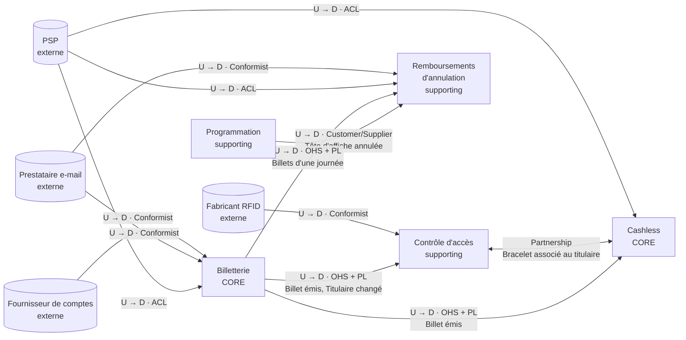

# Context Map · WaveFest

> TP2 · Découpage en Bounded Contexts à partir du mur du TP1 (`docs/tp1/`).
> Légende : **U** = amont (impose son modèle), **D** = aval (le subit). Le pattern est écrit sur le lien.

## 1. Les Bounded Contexts

| Contexte | Objectif (une phrase) | Classement | Acteurs |
|---|---|---|---|
| **Billetterie** | Vendre les pass en vagues avec quotas, émettre des billets nominatifs et gérer leur vie avant le festival (changement de nom, revente). | 🟥 Core | Acheteur, Titulaire, Vendeur, Racheteur, Organisateur |
| **Cashless** | Gérer le solde cashless de chaque bracelet : recharge, consommation et remboursement du solde. | 🟥 Core | Festivalier, Barman |
| **Contrôle d'accès** | Vérifier un billet au portique, l'échanger contre un bracelet et valider les entrées sur le site. | 🟧 Supporting | Bénévole au portique, Titulaire, Festivalier |
| **Programmation** | Publier le line-up et les horaires de passage, et prononcer l'annulation d'un concert. | 🟧 Supporting | Organisateur |
| **Remboursements d'annulation** | Rembourser les billets concernés quand une tête d'affiche est annulée. | 🟧 Supporting | Organisateur, Titulaire |

**Systèmes externes** (sous-domaines génériques du TP1) : PSP, Prestataire e-mail, Fabricant RFID, Fournisseur de comptes (inscription et connexion).

> La **Revente** et le **Changement de nom** restent dans la Billetterie : voir [ADR 0001](adr/0001-revente-dans-la-billetterie.md).

## 2. Pourquoi ces frontières

| Indice | Ce qu'on observe sur le mur |
|---|---|
| **Le sens change** | « Billet » = droit nominatif avec un prix (Billetterie) ; preuve à vérifier une seule fois (Contrôle d'accès) ; n'existe pas en Cashless, on parle de **bracelet** et de **solde**. |
| **Événements pivots** | « Billets émis » ferme la vente ; « Bracelet associé au titulaire » fait passer du billet au bracelet ; « Festival terminé » ouvre les remboursements du solde. |
| **Acteurs différents** | Acheteur/Vendeur/Racheteur (Billetterie), Bénévole au portique (Contrôle d'accès), Barman (Cashless), Organisateur (Programmation). |
| **Rythme de changement** | Prix et vagues changent à chaque édition ; règles du portique quasi jamais ; règles de remboursement fixées une fois (50 %, J+15, 1,50 €). |

## 3. Schéma

## 4. Les relations, une par une

| # | Amont (U) | Aval (D) | Pattern | Ce qui circule | Pourquoi ce pattern | Si l'amont change son modèle |
|---|---|---|---|---|---|---|
| 1 | Programmation | Remboursements d'annulation | **Customer / Supplier** | Événement `Tête d'affiche annulée` (concert, journée) | Les Remboursements ont un besoin précis (savoir quelle journée et si c'est une tête d'affiche) et peuvent le faire inscrire dans les priorités de la Programmation. | On négocie : le changement est planifié avec l'équipe aval. |
| 2 | Billetterie | Contrôle d'accès | **Open Host Service + Published Language** | Événements `Billet émis`, `Titulaire changé`, `Billet réémis au nouveau titulaire` | La Billetterie sert plusieurs consommateurs avec un même format publié et versionné. | Le langage publié est versionné : les consommateurs migrent à leur rythme. |
| 3 | Billetterie | Remboursements d'annulation | **Open Host Service + Published Language** | Requête « billets d'une journée » : titulaire actuel, type de pass, prix payé | Même service publié ; les Remboursements n'ont pas à connaître les commandes ni les vagues. | Idem : version du langage publié. |
| 4 | Billetterie | Cashless | **Open Host Service + Published Language** | Événement `Billet émis` (pour permettre la recharge en ligne avant le festival) | Même service publié. | Idem. |
| 5 | Contrôle d'accès | Cashless | **Partnership** | Événement `Bracelet associé au titulaire` (le solde en ligne est crédité sur le bracelet), `Bracelet bloqué` | Le bracelet sert à la fois à entrer et à payer : les deux équipes réussissent ou échouent ensemble au moment de l'ouverture des portes. | Décision commune, planifiée ensemble. |
| 6 | PSP | Billetterie | **Anticorruption Layer** | Appel « payer » + notification `Paiement confirmé` / `Paiement refusé` | Modèle étranger qu'on ne peut pas modifier : l'ACL traduit le vocabulaire du PSP en `Paiement confirmé` / `Paiement refusé`. | Seule l'ACL est modifiée ; le modèle de la Billetterie ne bouge pas. |
| 7 | PSP | Cashless | **Anticorruption Layer** | Recharge en ligne, remboursement du solde | Même raison. | Idem. |
| 8 | PSP | Remboursements d'annulation | **Anticorruption Layer** | Ordre de remboursement + `Remboursement effectué` / `Remboursement échoué` | Même raison ; la gestion des échecs du PSP reste dans l'ACL. | Idem. |
| 9 | Prestataire e-mail | Billetterie, Remboursements | **Conformist** | Appel d'envoi d'e-mail | Service du marché : l'amont ne bougera pas, et son modèle (destinataire, gabarit) suffit. | On s'adapte à sa nouvelle version. |
| 10 | Fabricant RFID | Contrôle d'accès | **Conformist** | Fichier des bracelets livrés (identifiants encodés) | On adopte le format du fabricant, on ne peut pas le négocier. | On s'adapte. |
| 11 | Fournisseur de comptes | Billetterie | **Conformist** | Identité de l'acheteur | Besoin commun à tous les sites (générique), on prend le modèle tel quel. | On s'adapte. |
| — | Bénévolat | — | **Separate Ways** | Rien | Le planning des bénévoles n'a aucune règle commune avec la vente : intégrer coûterait plus cher que dupliquer (un tableur suffit). | Aucun impact. |

## 5. Le mot « billet » selon le contexte

| Contexte | Ce que veut dire « billet » |
|---|---|
| Billetterie | Exemplaire d'un pass acheté, au nom d'un titulaire, avec un prix payé. |
| Contrôle d'accès | Preuve à présenter une fois au portique : valide, déjà utilisée ou refusée. |
| Remboursements d'annulation | Ligne à rembourser : un titulaire et un montant. |
| Cashless | N'existe pas : on parle de **bracelet** et de **solde cashless**. |

## 6. Questions ouvertes

- Les pass 3 jours et VIP sont-ils remboursés quand une tête d'affiche est annulée ? (hotspot du mur, sans réponse)
- Un bracelet perdu : le solde est-il récupéré sur le nouveau bracelet, et le remplacement est-il payant ? (hotspot du mur)
