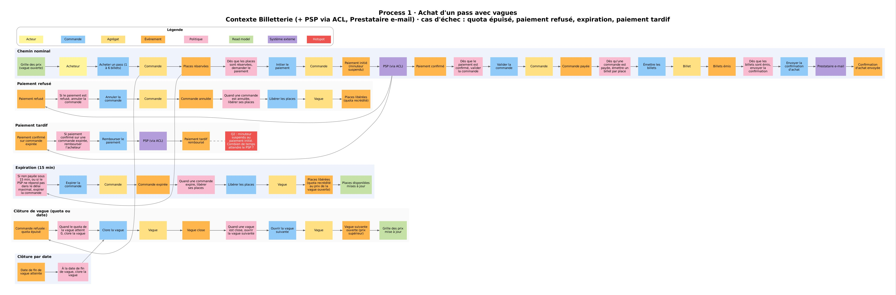
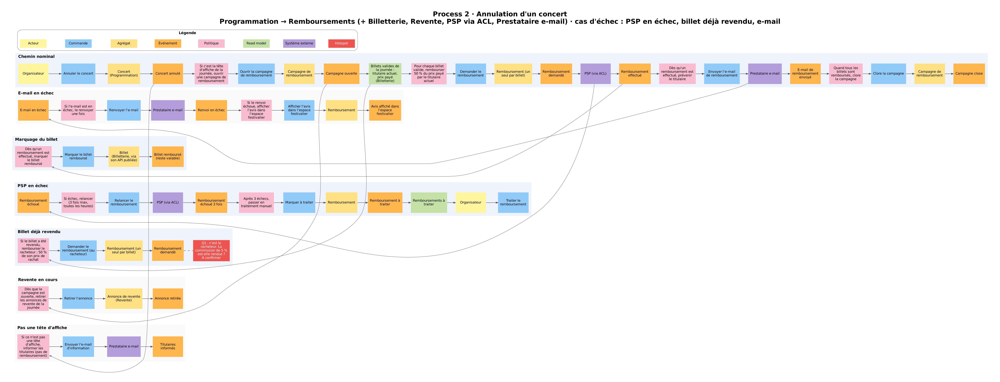

# Processus · Event Storming niveau process

> Recopiés du Miro, cadres **04** et **05**. Grammaire : Acteur → Commande → Agrégat → Événement → Politique → Commande… ; un read model informe l'acteur ; les systèmes externes passent par une ACL ou en Conformist.

## Process 1 · Achat d'un pass avec vagues (cadre 04)

| Ligne | Résumé |
|---|---|
| Chemin nominal | Grille des prix → Acheteur *Acheter un pass (1 à 6 billets)* → **Places réservées** → *Initier le paiement* → **Paiement initié (minuteur suspendu)** → PSP (ACL) → **Paiement confirmé** → *Valider la commande* → **Commande payée** → *Émettre les billets* → **Billets émis** → *Envoyer la confirmation* → Prestataire e-mail → **Confirmation d'achat envoyée** |
| Clôture de vague | **Commande refusée : quota épuisé** ou **Date de fin de vague atteinte** → *Clore la vague* → **Vague close** → *Ouvrir la vague suivante* → **Vague suivante ouverte (prix supérieur)** → Grille des prix mise à jour |
| Paiement refusé | **Paiement refusé** → *Annuler la commande* → **Commande annulée** → *Libérer les places* → **Places libérées (quota recrédité)** |
| Expiration (15 min) | Non payée sous 15 min ou PSP muet → *Expirer la commande* → **Commande expirée** → *Libérer les places* → **Places libérées** (au prix de la vague ouverte) |
| Paiement tardif | **Paiement confirmé sur commande expirée** → *Rembourser le paiement* → PSP (ACL) → **Paiement tardif remboursé** · hotspot Q2 |

## Process 2 · Annulation d'un concert (cadre 05)

| Ligne | Résumé |
|---|---|
| Chemin nominal | Organisateur *Annuler le concert* → **Concert annulé** → si tête d'affiche, *Ouvrir la campagne de remboursement* → **Campagne ouverte** → pour chaque billet valide, *Demander le remboursement* (50 %) → PSP (ACL) → **Remboursement effectué** → e-mail → … → *Clore la campagne* → **Campagne close** |
| Pas une tête d'affiche | Informer les titulaires, sans remboursement → **Titulaires informés** |
| Billet déjà revendu | Rembourser le racheteur, 50 % de son prix de rachat · hotspot Q1 (commission rendue ?) |
| Revente en cours | *Retirer l'annonce* → **Annonce retirée** (contexte Revente) |
| PSP en échec | Relancer 3 fois max, toutes les heures → puis **Remboursement à traiter** → Organisateur *Traiter le remboursement* |
| E-mail en échec | Renvoyer une fois → si échec, **Avis affiché dans l'espace festivalier** |
| Marquage du billet | *Marquer le billet remboursé* (Billetterie, via son API publiée) → **Billet remboursé (reste valable)** |

## Questions ouvertes pour l'expert

1. Combien de temps attendre le PSP une fois le paiement initié ? (Q2)
2. La commission de 5 % est-elle rendue au racheteur en cas d'annulation ? (Q1)
3. Les pass 3 jours et VIP sont-ils remboursés si une tête d'affiche est annulée ?
